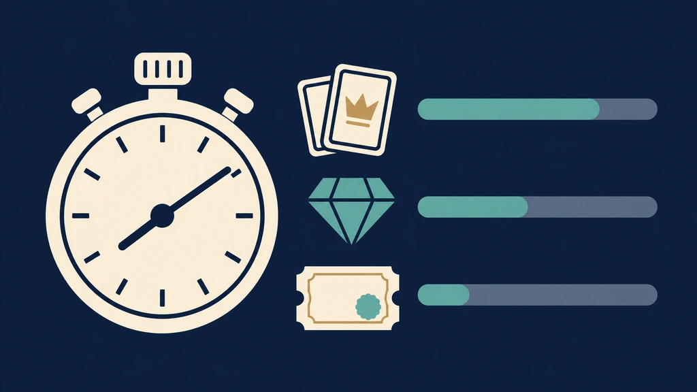

  

<h1 align="center">Chrono</h1>

타롯부터 기간제 아이템까지, 남은 시간을 한눈에.

  <a href="https://dhoport.app/navigator">DHO Navigator</a> ·
  <a href="https://github.com/DHO-Unofficial-Dev/dho-module-chrono/releases">릴리즈</a> ·
  <a href="https://dhoport.app/navigator/catalog/module/app.dhoport.vault">Vault</a> ·
  <a href="docs/DEVELOPMENT.md">개발 안내</a>

풍신의 보석은 며칠 남았는지, 공유 창고는 언제 끝나는지, 타롯을 쓴 지 얼마나 됐는지.
Chrono에 자주 쓰는 아이템을 등록해 두면 게임 화면의 작은 아이콘과 남은 시간으로 확인할 수 있어요.

한 번 등록한 아이템은 만료 후 다시 눌러 같은 기간으로 시작하면 됩니다. 매번 아이템을 찾아 등록할 필요는 없어요.

## 이렇게 쓸 수 있어요

- **작은 HUD:** 아이템 아이콘 아래에 `7d17h`, `23h17m`, `58m17s`처럼 남은 시간을 표시해요. 테두리 게이지로 남은 비율도 볼 수 있어요.
- **반복해서 쓰는 타이머:** 대기·만료 항목을 누르면 시작하고, 만료 날짜·시간이나 남은 시간을 직접 고칠 수 있어요. 타롯은 일시정지와 재개도 지원해요.
- **함께 시작하는 아이템:** 패널 카드의 사슬 버튼으로 연결해 두세요. 하나를 시작하면 연결된 대기·만료 항목도 각자의 기본 기간으로 시작해요. 이미 실행 중이거나 일시정지한 다른 항목은 그대로 유지합니다.
- **내 화면에 맞는 배치:** 가로·세로 방향, 아이콘 크기와 간격, 글자 크기, 선 두께, 배경 투명도를 조절할 수 있어요.
- **실제 아이템으로 등록:** Vault에서 이름으로 검색하면 아이콘과 설명을 함께 확인할 수 있어요. 자주 쓰는 아이템은 추천 목록에서 골라도 됩니다.

## 설치

DHO Navigator **2.2.2 이상**과 **Vault** 모듈이 필요해요.

[Chrono 1.1.0](https://github.com/DHO-Unofficial-Dev/dho-module-chrono/releases/tag/v1.1.0)이 공개되었습니다. 아래 순서로 설치해 주세요.

1. [Releases](https://github.com/DHO-Unofficial-Dev/dho-module-chrono/releases)에서 `chrono-1.1.0.dho-module`을 받아 Navigator의 모듈 관리에서 설치하세요.
2. [Vault](https://dhoport.app/navigator/catalog/module/app.dhoport.vault)를 설치하고 게임 폴더를 설정하세요.
3. Chrono의 서비스 연결에서 Vault를 선택하고 **아이템 읽기**를 허용하세요.
4. Chrono 패널을 열어 그룹 아래의 **아이템 추가**를 누르세요.
5. Chrono HUD를 켜고, **Navigator 설정 → 모듈 → Chrono**에서 HUD 조작 단축키를 지정하세요. `Ctrl+Shift+T`를 권장하지만 다른 기능과 겹치면 다른 조합을 사용하면 됩니다.

아이템 검색이 되지 않으면 먼저 Vault 연결 상태를 확인해 주세요. 이미 등록한 아이템의 이름·설명·아이콘은 로컬에 보관하므로 Vault 연결이 끊겨도 기존 타이머는 계속 사용할 수 있어요.

## HUD 조작

HUD는 평소에 게임 클릭을 통과시켜요. 지정한 단축키나 Navigator의 **Chrono HUD 조작** 기능으로 조작 모드에 들어간 뒤 눌러 주세요.

| 조작 | 동작 |
| --- | --- |
| 대기·만료 아이콘 좌클릭 | 등록한 기본 기간으로 시작 |
| 실행 중 타롯 좌클릭 | 일시정지 |
| 실행 중 일반 아이템 좌클릭 | 조작 메뉴 열기 |
| 일시정지 아이콘 좌클릭 | 남은 시간부터 재개 |
| 아이콘 우클릭 | 정지, 다시 시작, 만료 일시·남은 시간 보정 |
| 패널 카드의 사슬 버튼 | 동시 시작 연결·해제 |
| 패널 카드 왼쪽 손잡이 드래그 | 표시 순서 변경 |
| `Ctrl+Shift+E` | Navigator의 HUD 배치 화면 열기 |

정지는 아이템을 삭제하지 않고 대기로 돌려놓아요. 다시 시작은 그 시점부터 기본 기간을 새로 셉니다.

## 타롯과 기간제 아이템

추천 목록에는 빛나는 타롯(세계·여제), 풍신·아네모이 아이템, 공유 창고·선박 금고·스킬 노트 사용증, 선원 장비 손질 아이템이 들어 있어요. 추천에 없는 아이템도 검색해서 기간을 직접 입력할 수 있습니다.

**타롯의 접속 시간은 자동 감지하지 않아요.** 게임을 나가거나 접속이 끊기면 직접 일시정지하고, 다시 접속했을 때 재개해 주세요. 실행 중인 타이머는 Navigator를 꺼도 만료 시각을 기준으로 시간이 흐르고, 일시정지한 타이머는 남은 시간을 유지합니다.

타롯으로 보이는 검색 항목은 등록할 때 종류를 제안해요. 자동 분류가 맞지 않으면 직접 바꿔 주세요. 기존 항목도 설정에서 종류를 변경할 수 있어요. 이전 버전에서 일시정지한 일반 아이템은 그대로 보존하며 재개한 뒤에는 다시 일시정지할 수 없습니다.

만료 일시는 PC의 현지 시간으로 입력해요. 일시정지 중 보정하면 입력한 시각까지의 시간을 남은 시간으로 저장하고 정지를 유지합니다. 기본 기간은 바뀌지 않아요.

추천 기간은 등록을 돕는 기본값이에요. 실제 사용한 아이템의 이름과 기간을 확인해 주세요.

## 알아두세요

- 현재는 **그룹 하나와 HUD 하나**를 제공해요.
- 토스트 알림과 알람 소리는 제공하지 않아요.
- 게임의 아이템 사용·접속 상태를 자동 감지하거나 OCR로 읽지 않아요. 아이템을 사용한 뒤 직접 타이머를 시작해 주세요.
- HUD 메뉴를 펼치면 창 크기가 달라져 위치가 움직일 수 있어요. 설정에서 메뉴 방향을 아래나 오른쪽으로 두면 내부 아이콘 이동을 줄일 수 있습니다.
- 조작 모드에서는 HUD 창의 투명한 여백도 클릭을 받아요. 현재는 항상 클릭하는 모드로 전환할 수 없습니다.

## 권한과 저장

| 권한 | 사용하는 곳 |
| --- | --- |
| `services.consume` | Vault에서 아이템 정보와 아이콘 읽기 |
| `storage.local` | 타이머, 설정, 아이템 사본과 이미지 캐시 저장 |
| `actions.receive` | Navigator에서 지정한 HUD 조작 기능과 단축키 받기 |

Chrono에는 별도 실행 파일이나 상주 프로세스가 없고, 인터넷으로 아이템 데이터를 요청하지 않아요. 아이템 이미지는 모듈에 넣지 않고 로컬 Vault 서비스에서 받아 사용합니다.

## 개발과 라이선스

빌드 방법과 구조는 [개발 안내](docs/DEVELOPMENT.md), 변경 사항은 [CHANGELOG](CHANGELOG.md)에서 확인할 수 있어요.

코드는 [MPL-2.0](LICENSE)으로 공개합니다. 게임 아이템 이름과 원본 리소스의 권리는 각 권리자에게 있으며, 이 저장소에는 게임에서 추출한 아이템 이미지가 포함되지 않습니다.
